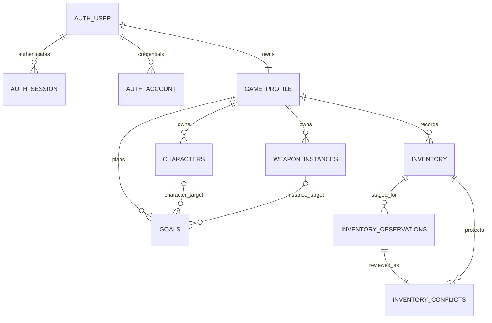

# Architecture and data contracts

Ilimmu is one Bun application with a PostgreSQL database. This page describes
the implemented manual-entry system.

## Runtime and database

Use SvelteKit 3 with its official Bun adapter, embedded Elysia under `/api`,
Tailwind and customized free FlyonUI, PostgreSQL, Drizzle, and Better Auth.
Pin Bun 1.4.0 and compatible stable packages. The compatibility research is in
`stack-compatibility.md`. Production is not a Node adapter running by assumption.
There is no Redis, queue, object store, Python sidecar, or permanent worker.

SvelteKit owns routing, SSR, and the network listener. Browser mutations call
authenticated, validated Elysia routes. SSR calls domain services directly.
`src/lib/contracts.ts` owns public schemas and inferred client types. Private
Drizzle schema types never enter client modules. Authentication identity and
the game profile are separate records.

## Owner authentication

Better Auth uses database sessions and email/password with signup disabled.
An operator provisions the only user through `bun run owner provision`.
A database uniqueness constraint enforces one owner even if two operator
commands race. Provisioning takes an advisory transaction lock.
`bun run owner reset` changes the credential and revokes sessions atomically;
there is no SMTP or public recovery workflow.

The server hook protects pages and APIs. Better Auth validates sessions on each
request; cookie caching is disabled so expiry, logout, and reset are effective
against the database. Browser mutations require same-origin requests.
Better Auth owns its authentication endpoint CSRF and cookie handling.
Database-backed authentication throttling does not require another service.

## Records, observations, and plans

Personal actual records have stable game definition IDs, separate internal UUIDs,
account foreign keys, UTC timestamps, revision numbers, source, and an explicit
manual-override marker. Duplicate weapons retain distinct UUIDs.
Display names entered manually are user labels, not verified static-catalog
identity mappings. No external game catalog is silently treated as current.
Future pinned catalogs remain separate from owned records and source observations.

Manual material edits are absolute quantities, not deltas. PostgreSQL constraints
and API schemas reject invalid quantities and progression. Material and Mora
quantities use nonnegative signed 32-bit integers; the UI must expose this bound.

Goals reference either an owned character or an individual weapon instance.
Multiple goals are allowed. Priority and explicit completion belong to the goal.
Targets and build notes never update actual progression.

## Initial ER model

The diagram shows the main record relationships.



Auth verification and rate-limit tables are infrastructure data, not exports.
No generic entity/attribute/value table is used.

## Safe-update flow

The shared provenance service supplies consistent missing/stale-write errors.
The persistence operation checks the account and expected revision in the same
SQL update and increments the revision atomically. A zero-row update returns 409.

```text
browser input -> session and origin boundary -> schema parse
  -> account-scoped service -> revision-conditional update
  -> commit source/manual marker/timestamp/revision together
  -> return saved record, or 409 without changing the previous value
```

Phase 1 fixture observations deliberately use the same future staging boundary
without implementing a production importer:

```text
fixture -> validate -> lock actual/revision -> immutable observation
  -> unresolved conflict -> explicit review
  -> lock conflict + actual -> verify both revisions
  -> accept source OR keep manual -> transactional resolution
```

Staging never changes actual quantities. Accept-source replaces the actual
quantity, sets observed provenance, clears the manual override, and increments
its revision. Keep-manual preserves the correction. Both record resolution.
A stale edit or failed transaction leaves observation, actual, and plans intact.
No automatic refresh, calculator, or source operation completes a goal.

## Versioned export contract

`GET /api/exports` is authenticated and returns a downloadable JSON envelope:
`format: "genshin-companion"`, `version: 1`, UTC `generatedAt`, profile,
characters, weapon instances, inventory, goals, observations, and conflicts.
The strict `exportSchema` validates an explicit allowlist inside a repeatable-read
transaction before recording `lastExportGeneratedAt`.

Authentication rows, owner identity/email, password hashes, tokens, keys, and
configuration are excluded. Version changes require an explicit new contract;
this export is not claimed to be GOOD. A browser download proves generation,
not that the user saved a backup. The UI labels the timestamp GENERATED and
reminds after seven days or when no export exists.
Operator `pg_dump` is a separate full-database backup and contains sensitive auth
data; store it outside the web application and rehearse restore in isolation.


The export format identifier stays `genshin-companion` for compatibility.
Downloaded filenames use `ilimmu-v1-YYYY-MM-DD.json`.
