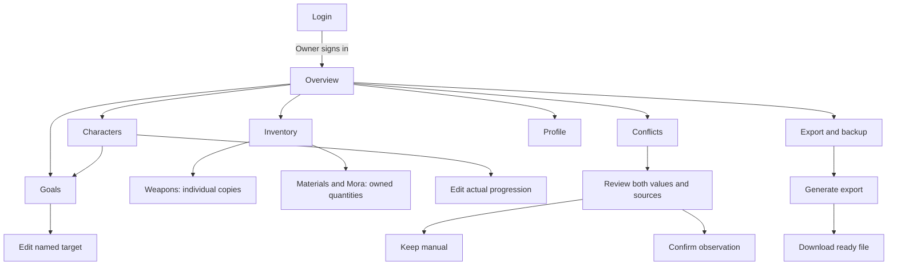
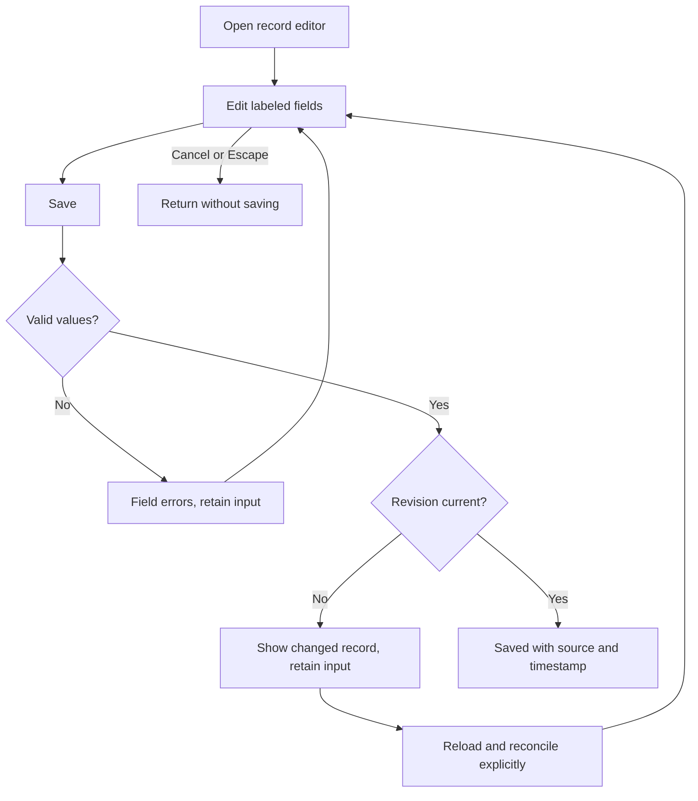

# Navigation and task flows

Phase 1.5 defines the navigation and state contracts for the Ilimmu
and reserves clear locations for later features. The visual rules are in
[DESIGN.md](../DESIGN.md). Future destinations below are planning locations,
not implemented routes or working items in the current navigation.

## Current sitemap

Every protected destination is reachable through the desktop rail or mobile
Menu. Inventory groups the existing weapons and materials routes with tabs.

The current route mapping keeps existing URLs stable until implementation
deliberately migrates them. In-app display labels can improve without a route
rename.

| Display destination | Existing route | Design responsibility |
| --- | --- | --- |
| Overview | `/` | Continue a build; choose a pending task |
| Characters | `/characters` | Owned roster and editable actual progression |
| Inventory, Materials tab | `/inventory` | Absolute material and Mora quantities |
| Inventory, Weapons tab | `/weapons` | Distinct copies, level, ascension, refinement |
| Goals | `/goals` | Independent named targets and priority |
| Conflicts | `/conflicts` | Protected current value versus observation |
| Profile | `/profile` | UID and explicit server |
| Export & backup | `/export` | Generation, readiness, and download |
| Login | `/login` | Sole-owner authentication |

## Editing and data protection

An edit belongs to one explicit record type. Never reuse a generic Save action
without a heading that identifies whether the user is editing actual data or
a target.

Target saving changes only the selected target. Actual saving records manual
provenance. A conflict decision changes only its selected field after checking
the revision. A retry never resets the form to blank values.

## Required screen states

The library specifies visual states. Application implementation must supply
the corresponding semantics and transitions.

| Context | Required states | Recovery or next action |
| --- | --- | --- |
| Login | Default, submitting, rejected credentials, throttled, network error | Preserve email; explain retry timing when known |
| Lists | Loading, empty, content, filtered-empty, failed, stale | Add record, clear filters, or retry |
| Forms | Default, dirty, invalid, saving, saved, stale revision, failed | Retain input and focus first invalid field |
| Goal targets | Active, Maintain, Planned for Later, completed | Edit selected target; actual remains unchanged |
| Conflict review | Both values, confirming, resolving, resolved, stale revision, failed | Explicit Keep manual or Accept observation |
| Export | Never generated, reminder due, pending, ready, failed | Generate, retry, or download |
| Mobile menu | Closed, open, active destination, keyboard focus | Navigate, Escape, close, restore trigger focus |

Loading layouts reserve the content's geometry. Empty states explain what is
missing. Stale states show the last known date. Do not show synthetic account
totals as real values while a request is pending.

## Later-phase sitemap

Reserve these locations rather than putting nonfunctional links into the
Phase 1 navigation. Reuse the same shell, field anatomy, sources, and feedback.

| Phase | Destination | Task and design reuse |
| --- | --- | --- |
| 2 | Profile → Connections | Connector status, last success, reconnect, disconnect; reuse source/status components |
| 2 | Inventory → Import | File selection, parse summary, preview, conflicts, commit receipt; never infer full roster from showcase |
| 3 | Goals → Requirements | Actual versus target material calculations; label assumptions and unavailable data |
| 3 | Farming | Prioritized checklist linked to goals and owned inventory; named server-day context |
| 4 | Overview → Customize | Section order/visibility without changing record meaning |
| 4 | Wishes | Banner records, editable balances, pity/guarantee inputs, explicit calculation assumptions |
| 5 | Advisor | Read-only context and cited advice; no Save-to-account action |
| 6 | Artifacts and Teams | Inventory filters, saved builds, comparisons, optimizer constraints |
| 7 | Profile → Data management | Deletion, backup/recovery guidance, optional connection controls after approval |

Later feature phases still need their own detailed screen and behavior specs.
Phase 1.5 establishes the system and placement, not final unsupported
integration payloads or invented future results.

## Responsive and accessibility rules

Use a labeled mobile Menu rather than an unlabeled icon. Its drawer exposes
all destinations, the current page, and Sign out. Close the drawer on navigation
and return focus on cancellation. Keep document scrolling independent of the
navigation; prevent a fixed control bar from covering the final form action.

Stack conflict and actual/target values with their labels. Preserve weapon-copy
identity, source, and timestamp on mobile. Inputs stay at least 16px in browser
implementation. For long forms, keep the primary action after the fields and
let the form scroll rather than shrinking labels.
