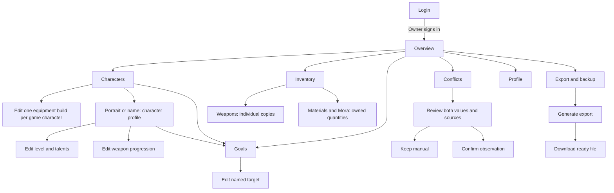
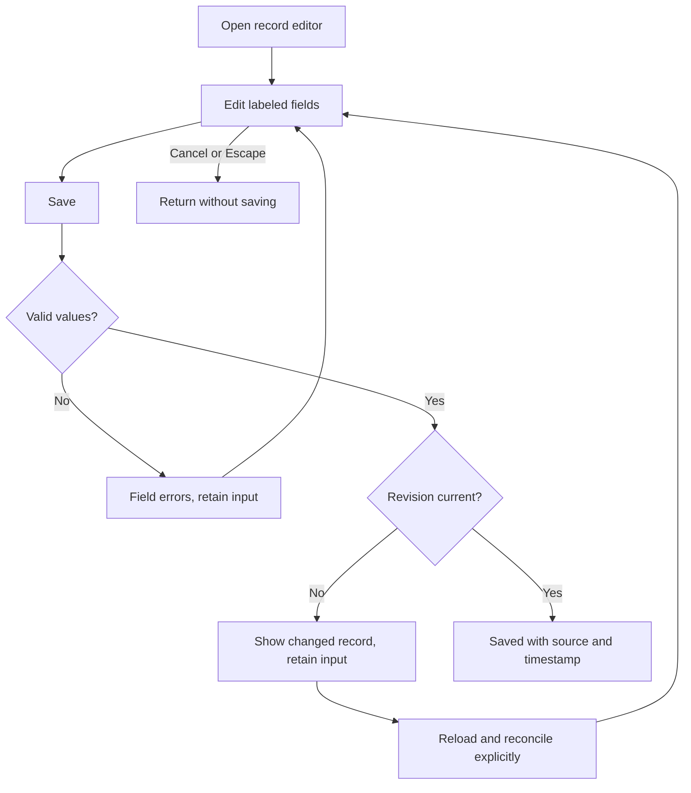

# Navigation and task flows

Phase 1.5 defines the navigation and state contracts for the Ilimmu
and reserves clear locations for later features. The visual rules are in
[DESIGN.md](../DESIGN.md). Future destinations below are planning locations,
not implemented routes or working items in the current navigation.

## Current sitemap

Every protected destination is reachable through the desktop rail or mobile
Menu. Inventory groups the existing weapons and materials routes with tabs.

The current route mapping keeps existing URLs stable until implementation
deliberately migrates them. In-app display labels can improve without a route
rename.

| Display destination | Existing route | Design responsibility |
| --- | --- | --- |
| Overview | `/` | Continue a build; choose a pending task |
| Characters | `/characters` | Static roster, ownership, filters, and inline equipment builds |
| Character profile | `/characters/[gameId]` | Actual level and talents, weapon progression, equipment, and independent targets |
| Inventory, Materials tab | `/inventory` | Absolute material and Mora quantities |
| Inventory, Weapons tab | `/weapons` | Distinct copies, level, ascension, refinement |
| Goals | `/goals` | Independent named targets and priority |
| Conflicts | `/conflicts` | Protected current value versus observation |
| Profile | `/profile` | UID and explicit server |
| Export & backup | `/export` | Generation, readiness, and download |
| Login | `/login` | Sole-owner authentication |

## Characters and equipment builds

The versioned Wiki catalog supplies 121 matched playable character identities,
63 artifact sets, and 252 weapons. The app projects Traveler into seven
elemental entries, for 127 roster entries total.
Legacy Aether and Lumine progression and build records remain intact;
Anemo ownership changes synchronize the two legacy alias IDs atomically.
The other six elements have independent progression and builds. The roster selects a
matching retained record and build without deleting legacy records.

The static game catalog supplies the roster; you mark characters owned instead
of creating them. Search and filters include ownership, element, weapon type,
and rarity, with name or level sorting. Elements and weapon types use icon
buttons; rarity uses numbered star buttons. Multiple choices within a group
match either choice; different groups combine. Searches accept rarity terms
such as `5 ★`, `4*`, and `5-star`. Portraits and names open the profile.
On mobile, **Filters** expands the groups and sorting. Its count and the result
summary keep selected filters visible when collapsed. Clear filters resets
search, ownership, group selections, and sorting.
Filtering hides rows while keeping their unsaved build drafts in memory.

Character portraits use rarity backgrounds even when not owned. The weapon
picker and Weapons page share the rarity controls and search behavior. Build
fields respond to their container width so the sidebar cannot squeeze them.

Build and progression editors save against the revision originally loaded into
the form. If newer data arrives while editing, the draft stays intact and a
message offers Reset to load the newer values. A stale save is rejected instead
of borrowing the refreshed revision and overwriting another edit.

Owned characters and characters with saved builds show inline equipment.
For other characters, **Plan build** opens equipment editing before ownership.
Choose a compatible weapon, a four-piece artifact set or two two-piece effect
bonuses, and valid Sands, Goblet, and Circlet main stats. Official white category icons from Wiki File pages accompany text labels.
They are category symbols, not sample artifact pieces. Two-piece mode records bonuses rather than selected set
identities. Equivalent Wiki wording and punctuation share one semantic
bonus key, so duplicate bonuses are validated against all matching sets. It shows supporting sets and permits the same bonus twice only
when at least two distinct sets support it. This is equipment planning, not
artifact inventory or optimization. Role, substat, and weight fields are absent.

Equipment uses image-only 64px tiles with rarity-colored backgrounds. Hover
waits 180ms before showing details; keyboard focus shows details immediately.
Desktop detail popovers ignore pointer events to keep tiles selectable. On
touch devices, an explicit info button opens interactive picker details.
Two-piece effect rows show overlapping 36px set icons with accessible names
and no visible per-set labels.

Picker selections update a draft. **Save build** validates and writes that
character's single build using its revision; **Reset** restores saved values.
Builds are keyed by static game character ID and can exist without a character
progression record. Weapon progression belongs to this build, separately from
individual weapon copies in Inventory.

The profile has **Level & talents**, **Weapon & artifacts**, and **Progression
targets** sections. Character progression saves actual level, ascension, and
base talents separately from equipment and weapon progression. A character
without a progression record prompts **Mark owned** before progression or
linked target creation. Marking an existing record not owned retains the
record, progression, targets, and build; it does not delete them or prevent
editing the retained record.

Ownership writes use the character revision, while build writes use the build
revision. Errors retain the current editing draft. Named progression goals
stay separate from actual progression and equipment builds. Exports include
builds; older export data without builds defaults to an empty build list.

On narrow screens, the two equipment tiles remain side by side. Each main-stat row keeps its
icon and label beside the select. The existing shell and other routes remain
outside this redesign's scope.

Reference data is a local snapshot, independent of account persistence and
live Wiki availability. The cache and manifest record retrieval times, page IDs,
revisions, and unmapped entries. Prepare an update with
`python3 scripts/sync-wiki-catalog.py --refresh --download-art`, review it, then
repeat with `--apply`. Offline runs reproduce cached data. Unknown identities
fail until their stable game IDs are reviewed; saved effects retain aliases
for earlier wording. The previous bootstrap importer is removed. See the
[Wiki catalog audit](wiki-catalog-research.md) for source evidence.

## Editing and data protection

An edit belongs to one explicit record type. Never reuse a generic Save action
without a heading that identifies whether the user is editing actual data or
a target.

Target saving changes only the selected target. Actual saving records manual
provenance. A conflict decision changes only its selected field after checking
the revision. A retry never resets the form to blank values.

## Required screen states

The library specifies visual states. Application implementation must supply
the corresponding semantics and transitions.

| Context | Required states | Recovery or next action |
| --- | --- | --- |
| Login | Default, submitting, rejected credentials, throttled, network error | Preserve email; explain retry timing when known |
| Lists | Loading, empty, content, filtered-empty, failed, stale | Add supported record, clear filters, or retry; Characters uses ownership and Plan build |
| Forms | Default, dirty, invalid, saving, saved, stale revision, failed | Retain input and focus first invalid field |
| Goal targets | Active, Maintain, Planned for Later, completed | Edit selected target; actual remains unchanged |
| Conflict review | Both values, confirming, resolving, resolved, stale revision, failed | Explicit Keep manual or Accept observation |
| Export | Never generated, reminder due, pending, ready, failed | Generate, retry, or download |
| Mobile menu | Closed, open, active destination, keyboard focus | Navigate, Escape, close, restore trigger focus |

Loading layouts reserve the content's geometry. Empty states explain what is
missing. Stale states show the last known date. Do not show synthetic account
totals as real values while a request is pending.

## Later-phase sitemap

Reserve these locations rather than putting nonfunctional links into the
Phase 1 navigation. Reuse the same shell, field anatomy, sources, and feedback.

| Phase | Destination | Task and design reuse |
| --- | --- | --- |
| 2 | Profile → Connections | Connector status, last success, reconnect, disconnect; reuse source/status components |
| 2 | Inventory → Import | File selection, parse summary, preview, conflicts, commit receipt; never infer full roster from showcase |
| 3 | Goals → Requirements | Actual versus target material calculations; label assumptions and unavailable data |
| 3 | Farming | Prioritized checklist linked to goals and owned inventory; named server-day context |
| 4 | Overview → Customize | Section order/visibility without changing record meaning |
| 4 | Wishes | Banner records, editable balances, pity/guarantee inputs, explicit calculation assumptions |
| 5 | Advisor | Read-only context and cited advice; no Save-to-account action |
| 6 | Artifacts and Teams | Artifact inventory, teams, comparisons, and optimizer constraints beyond the current single equipment build |
| 7 | Profile → Data management | Deletion, backup/recovery guidance, optional connection controls after approval |

Later feature phases still need their own detailed screen and behavior specs.
Phase 1.5 establishes the system and placement, not final unsupported
integration payloads or invented future results.

## Responsive and accessibility rules

Use a labeled mobile Menu rather than an unlabeled icon. Its drawer exposes
all destinations, the current page, and Sign out. Close the drawer on navigation
and return focus on cancellation. Keep document scrolling independent of the
navigation; prevent a fixed control bar from covering the final form action.

Stack conflict and actual/target values with their labels. Preserve weapon-copy
identity, source, and timestamp on mobile. Inputs stay at least 16px in browser
implementation. For long forms, keep the primary action after the fields and
let the form scroll rather than shrinking labels.
